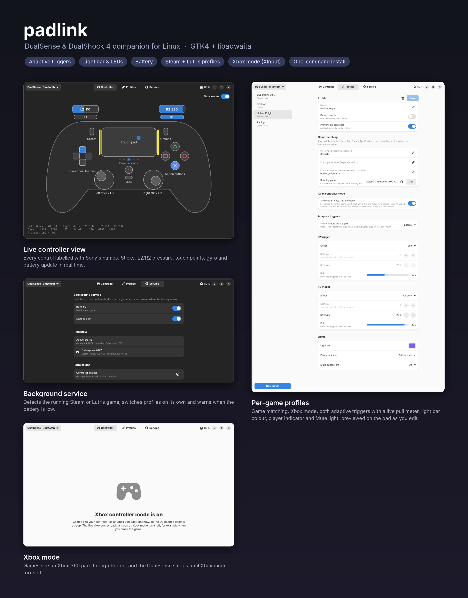
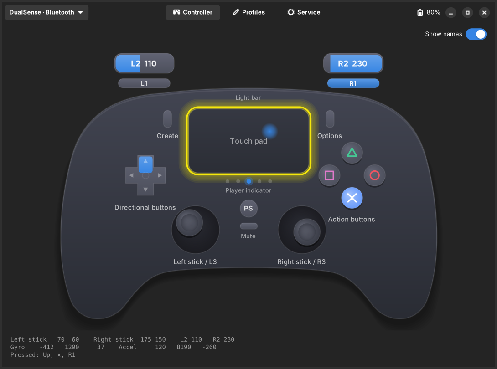
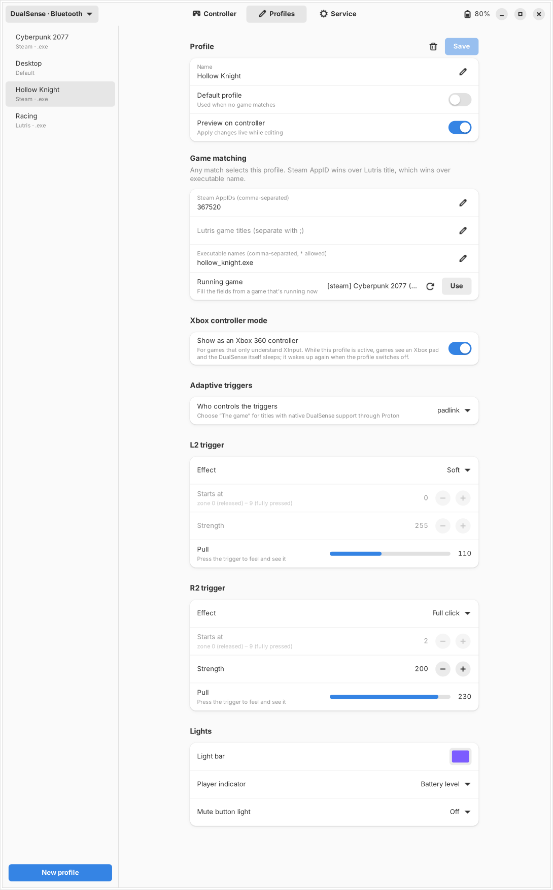

<div align="center">

# padlink

**DualSense & DualShock 4 companion for Linux**

Adaptive triggers · Light bar & LEDs · Battery · Per-game profiles for Steam and Lutris · Xbox mode (XInput)

[](https://github.com/Miguel7Coelho/padlink/actions/workflows/ci.yml)
[](https://github.com/Miguel7Coelho/padlink/releases)
[](LICENSE)




</div>

> [!NOTE]
> **padlink is vibe-coded and in continuous improvement.**
> It was built through AI-assisted development (Claude) and is still evolving release by release.
> It has automated tests and runs in CI against simulated controllers, but it hasn't been verified
> on every controller, distribution and game yet, so expect rough edges. Please
> [report what works and what doesn't](https://github.com/Miguel7Coelho/padlink/issues/new/choose).
> Every report helps.

---

## Contents

- [About](#about)
- [Features](#features)
- [Requirements](#requirements)
- [Download](#download)
- [Install](#install)
- [Usage](#usage)
- [Profiles](#profiles)
- [Xbox mode (XInput)](#xbox-mode-xinput)
- [How it works](#how-it-works)
- [Troubleshooting](#troubleshooting)
- [Contributing](#contributing)
- [Roadmap](#roadmap)
- [License](#license)

## About

padlink is a Linux tool in the spirit of [DS4Windows](https://github.com/ds4windowsapp/DS4Windows).
On Linux the kernel (`hid-playstation`) already drives PlayStation controllers, and Steam and Proton
already present them to games. padlink adds what's missing: adaptive triggers, lights, battery
warnings, per-game profiles chosen automatically from Steam and Lutris, and an Xbox mode for games
that only understand XInput.

It uses Sony's own names for every control (Create, Options, PS, Mute, Touch pad, Action buttons,
Light bar, Player indicator).

> padlink is an independent project. It is not affiliated with, endorsed by or sponsored by
> Sony Interactive Entertainment, Microsoft or Valve.

## Features

| | |
|---|---|
| 🎯 **Adaptive triggers** | 17 effects per trigger (resistance, bow, guns, galloping, vibrate, click…), with a live pull meter so you can feel a setting and see it at the same time |
| 💡 **Lights** | Light bar colour, player indicator (player number or battery bar), Mute button light |
| 🔋 **Battery** | Level in the GNOME top bar, the app and the CLI; notification below 25% (and 10%); the light bar turns red until you charge |
| 🎮 **Per-game profiles** | Detects the running game by Steam AppID, Lutris title or `.exe` name and switches profiles automatically |
| 🕹️ **Xbox mode** | Games see an Xbox 360 pad (XInput under Proton); the real controller sleeps meanwhile, so games don't see two pads, and rumble is forwarded |
| 🖥️ **Desktop app** | GTK4 + libadwaita: live controller view, profile editor, service control; light and dark themes |
| ⚙️ **Background service** | systemd user service; runs as you, no root daemon |
| 📦 **One-command install** | `./install.sh` installs everything; `--uninstall` removes it |

### Supported controllers

| Controller | USB | Bluetooth | Adaptive triggers | Light bar | Xbox mode |
|---|:-:|:-:|:-:|:-:|:-:|
| DualSense (054C:0CE6) | ✅ | ✅ | ✅ | ✅ | ✅ |
| DualSense Edge (054C:0DF2) | ✅ | ✅ | ✅ | ✅ | ✅ |
| DualShock 4 v1 / v2 (05C4 / 09CC) | ✅ | ✅ | — | ✅ | ✅ |
| DualShock 4 USB wireless adapter (0BA0) | ✅ | — | — | ✅ | ✅ |

## Requirements

- Linux with kernel **5.12+** for the DualSense, **6.2+** for the DualShock 4 on `hid-playstation`
  (Fedora, Arch, Ubuntu 23.04+ and openSUSE Tumbleweed are fine)
- Python **3.11+**
- For the app: PyGObject, GTK **4.10+**, libadwaita **1.5+**
- For Xbox mode: python-evdev and the `uinput` kernel module
- systemd (for the background service) and sudo

`install.sh` installs all of these through `dnf`, `apt`, `pacman` or `zypper`.

## Download

Get the latest **padlink-x.y.z.zip** from [Releases](https://github.com/Miguel7Coelho/padlink/releases),
or clone the repository:

```bash
git clone https://github.com/Miguel7Coelho/padlink.git
```

`main` always holds the latest stable release; `develop` holds what's coming next (see
[CONTRIBUTING](CONTRIBUTING.md#branches)).

## Install

```bash
cd padlink
./install.sh
```

Run it as your normal user, without `sudo`. It asks for your password **once**, then installs silently
and writes a log to `~/.cache/padlink/install.log`. It installs:

| What | Where |
|---|---|
| Program | `~/.local/share/padlink`, commands `padlink` and `padlink-gui` in `~/.local/bin` |
| App launcher | `~/.local/share/applications` |
| Example profiles (only if you have none) | `~/.config/padlink/profiles` |
| Background service (enabled and started) | `~/.config/systemd/user/padlink.service` |
| Top-bar battery indicator (GNOME) | `~/.local/share/gnome-shell/extensions/padlink-battery@miguel7coelho.github.io` |
| Controller + uinput access | `/etc/udev/rules.d/70-padlink.rules`, `/etc/modules-load.d/padlink-uinput.conf` |
| Xbox mode helper | `/usr/local/libexec/padlink-hide` + `/etc/sudoers.d/padlink` ([why](SECURITY.md)) |

```bash
./install.sh --verbose             # show every step
./install.sh --no-service          # don't enable the background service
./install.sh --no-extension        # don't install the top-bar battery indicator
./install.sh --uninstall           # remove padlink, keep profiles
./install.sh --uninstall --purge   # remove padlink and profiles
```

Running it again updates padlink and keeps your profiles. If your controller was connected during
the install, reconnect it once.

## Usage

### App

Open **padlink** from the app grid, or run `padlink gui`.

| Page | What it does |
|---|---|
| **Controller** | Live drawing of the pad: buttons, sticks, L2/R2 pressure, touch points, gyro and accelerometer, battery. The ⏻ button in the header turns a Bluetooth controller off |
| **Profiles** | Game matching, Xbox mode, both adaptive triggers, light bar, player indicator, Mute light; changes preview on the controller as you edit |
| **Service** | Start/stop the background service, start at login, the detected game and active profile, permission check |

<p align="center">
  
  
</p>

### Command line

```text
padlink list                                   controllers, connection, battery
padlink games                                  running game + the profile that would be used
padlink trigger right rigid                    set a trigger now (left | right | both)
padlink trigger both resistance --start 3 --force 200
padlink led "#ff00aa"                          light bar colour ("off" to turn it off)
padlink player battery                         player indicator: 1-4 | battery | off
padlink apply cyberpunk                        apply a profile by file name
padlink effects                                list trigger effects
padlink xbox                                   Xbox mode now, until Ctrl+C
padlink off                                    turn the controller off (Bluetooth)
padlink gui                                    open the app
padlink daemon -v                              run the background service in the foreground
```

## Profiles

One TOML file per profile in `~/.config/padlink/profiles/`. Edit them in the app, or by hand:

```toml
name = "Cyberpunk 2077"

[match]                          # any rule selects the profile
steam_appid = [1091500]          # strongest match
lutris = ["Cyberpunk 2077"]      # Lutris game title
exe = ["cyberpunk2077.exe"]      # executable name, * allowed

[xbox]
enabled = false                  # true = games see an Xbox 360 pad

[triggers]
mode = "override"                # "override": padlink sets the triggers | "game": the game does
left  = { effect = "resistance",    start = 2, force = 160 }
right = { effect = "semi_auto_gun", start = 4, force = 220 }

[leds]
color = "#fcee0a"
player_leds = 1                  # 1-4 | "battery" | "off"
mic_led = "off"                  # "off" | "on" | "pulse"
```

- A profile with `default = true` (or named `default.toml`) is used when no game matches.
- Find a Steam AppID with `padlink games` while the game runs, or from its store URL.
- Use `mode = "game"` for titles with native DualSense support through Proton (Cyberpunk 2077,
  Ratchet & Clank, Spider-Man, Returnal…).

**Trigger effects:** `off` `rigid` `pulse` `soft` `medium` `hard` `very_hard` `hardest` `full_click`
`gamecube` `choppy` `resistance` `bow` `galloping` `semi_auto_gun` `auto_gun` `machine` `vibrate`

## Battery

- **Top bar:** a gamepad icon with the controller's battery percentage sits in GNOME's top bar. It
  turns red when the battery is low, shows ⚡ while charging, and hides when no controller is
  connected. Click it for details or to open padlink. It appears after you log out and back in
  once after installing.
- **Low battery:** below **25%** you get a notification, and the light bar turns **red** until you
  plug the controller in; then it goes back to your profile's colour. A second, urgent
  notification comes below 10%.

Change the thresholds or the colour in `~/.config/padlink/settings.toml`:

```toml
[battery]
low_below = 25          # notify + red light bar below this percentage
critical_below = 10     # urgent notification
low_light = true        # false = notifications only, leave the light bar alone
low_color = "#ff0000"
```

## Xbox mode (XInput)

Linux has no DirectInput or XInput; under Proton, XInput is built from whatever controller Linux
exposes. Xbox mode makes that controller an Xbox 360 pad:

1. padlink creates a virtual **Xbox 360 controller** (045E:028E, the same IDs a wired 360 pad has on
   the `xpad` driver) through `uinput`. Proton, SDL and Steam see an Xbox pad.
2. The real controller **sleeps**. padlink grabs its input nodes, and the helper `padlink-hide`
   removes access to its `/dev/hidraw*`, `/dev/input/event*` and `/dev/input/js*` nodes, so Steam,
   SDL, Proton and Wine can't open it and games don't see two controllers. padlink opened those
   nodes first, so it keeps reading buttons and driving lights, triggers and rumble.
3. Rumble that games send to the Xbox pad is forwarded to the controller's motors.
4. When Xbox mode ends (the profile switches off, padlink stops or the controller disconnects), the
   virtual pad is removed and the original permissions are restored. If padlink crashes, the
   service restores them when it stops and again on its next start.

To try it without starting the game, open the profile in the app with **Preview on controller**
on and switch on **Show as an Xbox 360 controller**: the background service starts Xbox mode within
a couple of seconds, and the Controller tab shows a banner plus the Xbox names (A/B/X/Y, LB/RB,
LT/RT, Back/Start/Guide) on the drawing. Test it at
[controllertest.org/xinput](https://controllertest.org/xinput) or `evtest`.

Square and Triangle are swapped on the way: the kernel reports them positionally, while the `xpad`
layout that games expect puts Xbox **X** on `BTN_X` and **Y** on `BTN_Y`.

## How it works

```text
             ┌──────────── padlink (runs as you) ────────────┐
DualSense ──►│ hidraw: read input, write output reports       │──► triggers, lights, rumble
 USB / BT    │ sysfs:  battery                                │
             │ /proc:  Steam / Lutris game detection ─► profile│
             │ evdev ─► uinput "Xbox 360 pad"   (Xbox mode)   │──► games via SDL / Proton (XInput)
             └────────────────────────────────────────────────┘
                     padlink-hide (root, via sudo): hide / restore the real pad's nodes
```

| Module | Role |
|---|---|
| [`devices.py`](padlink/devices.py) | Finds controllers in sysfs (`/sys/bus/hid/devices/*:054C:*`) |
| [`reports.py`](padlink/reports.py) | Output reports: DualSense USB 0x02 / BT 0x31 and DS4 0x05 / 0x11, CRC32. Only the fields being changed are flagged, so padlink never fights the kernel driver |
| [`triggers.py`](padlink/triggers.py) | Adaptive-trigger effects (ported from DS4Windows) |
| [`inputs.py`](padlink/inputs.py) | Decodes input reports into Sony's control names |
| [`games.py`](padlink/games.py) | Game detection from `/proc` (Steam `SteamAppId`, `reaper SteamLaunch`, `lutris-wrapper`) |
| [`profiles.py`](padlink/profiles.py) | TOML profiles, matching, saving |
| [`xinput.py`](padlink/xinput.py) | Xbox mode: evdev grab, uinput Xbox 360 pad, rumble forwarding |
| [`daemon.py`](padlink/daemon.py) | Background service loop |
| [`gui/`](padlink/gui) | GTK4 / libadwaita app |
| [`packaging/padlink-hide`](packaging/padlink-hide) | Root helper for Xbox mode ([security notes](SECURITY.md)) |

## Troubleshooting

See **[TROUBLESHOOTING.md](TROUBLESHOOTING.md)**. Quick checks:

```bash
padlink list                                # is the controller found? battery?
padlink games                               # is the game detected? which profile?
systemctl --user status padlink             # is the service running?
journalctl --user -u padlink -n 50          # service log
cat ~/.cache/padlink/install.log            # installer log
```

Most common fixes:

- **"Permission denied"**: run `./install.sh`, then reconnect the controller.
- **Light bar keeps changing back**: Steam Input is setting it. Turn off *PlayStation controller
  support* for that game in Steam, or let Steam handle the colour.
- **Two controllers in a game while in Xbox mode**: the helper didn't run; see
  [Xbox mode](TROUBLESHOOTING.md#xbox-mode).
- **Controller missing after a crash**: run `sudo /usr/local/libexec/padlink-hide show-all`.

## Contributing

Bug reports, testing on other distributions and controllers, and pull requests are welcome. See
[CONTRIBUTING.md](CONTRIBUTING.md) for the branch model, commit style and how to run the tests.

## Roadmap

- [x] Adaptive triggers, lights, battery, per-game profiles
- [x] GTK4 app and background service
- [x] Xbox mode with rumble; the real pad sleeps while it's active
- [x] One-command installer / uninstaller
- [ ] Verification on more hardware (please report results!). padlink is in continuous
      improvement, and the roadmap moves with feedback
- [ ] Remapping, and gyro to mouse/stick
- [ ] DSU (Cemuhook) server for emulators
- [x] Battery indicator in the GNOME top bar, red light bar when low
- [ ] Flatpak / RPM / AUR packages

## License

padlink is free software under the **GNU General Public License v3.0 or later**; see [LICENSE](LICENSE).
The adaptive-trigger effects and report layouts are derived from DS4Windows (GPLv3); see
[NOTICE.md](NOTICE.md).

DualSense, DualShock and PlayStation are trademarks of Sony Interactive Entertainment Inc. Xbox
is a trademark of Microsoft Corporation. Steam is a trademark of Valve Corporation.
